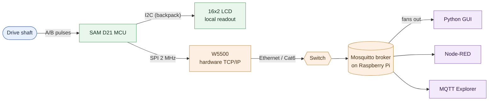

# 1 · The Big Picture

> Read this first. It walks the whole signal path once, slowly, and explains
> why each technology was chosen over its alternatives. Later docs zoom in on
> each box.

---

## 1.1 The problem, stated plainly

A metal extrusion line pulls material through at roughly **7 feet per second**.
The customer wants to see that speed, live, from an office — for several
machines, in an old building — without paying $1,000–2,000 per machine for an
industrial EtherNet/IP encoder.

So the whole project is one question: *how do you measure a shaft's speed
cheaply and get that number onto an office network reliably?*

Everything downstream of that is engineering trade-offs. Here's the whole chain
at a glance — every box is a hop we'll walk through below, and later docs zoom
into each one:

Everything downstream of hop 1 is engineering trade-offs. Let's walk the chain.

---

## 1.2 The signal path, one hop at a time

### Hop 1 — Shaft → electrical pulses (the encoder)

An **incremental quadrature encoder** is bolted to the drive shaft. As the shaft
turns, it emits two square waves, called **A** and **B**, 90° out of phase. The
number of pulses tells you how far the shaft turned; which signal leads (A
before B, or B before A) tells you the direction.

Why an encoder and not something simpler?

| Alternative | Why not |
|---|---|
| Tachometer (1 pulse/rev) | Too coarse. At low RPM you'd wait a whole revolution for one update. |
| Analog tach (voltage ∝ speed) | Needs an ADC, drifts, noisy in a plant full of motor interference. |
| Optical "beam break" | Grease and mist in an extrusion plant blind it. |

A quadrature encoder gives **hundreds of pulses per revolution**, so speed
updates many times per rev even at low RPM, and it gives direction for free.
That's hop 1. Covered in depth in [doc 3](03-encoder-and-math.md).

### Hop 2 — Pulses → a number (the microcontroller)

A **SAM D21** (an ARM Cortex-M0+ running at 48 MHz, 3.3 V) counts those edges.
It does three jobs:

1. **Decode** the A/B edges into a signed count (forwards adds, backwards
   subtracts), and time the edges to compute RPM.
2. **Convert** that to a human number: revolutions → feet of material, RPM →
   feet per second.
3. **Report** it — on a local LCD, over a serial debug cable, and over the
   network.

Why a microcontroller instead of buying a networked encoder? Cost and control.
~$100–250 of parts per machine instead of $1–2k, and we own the math and the
data format completely.

Why *this* microcontroller? It's a Microchip part (Ramon works at Microchip —
the dev board, the toolchain, and the support are all in-house), it's cheap, and
it's more than fast enough: at the production target (600 pulses/rev, 420 RPM ≈
16,800 edges/sec) the decoding uses about **7% of the CPU**. See
[doc 3](03-encoder-and-math.md) for the "is it fast enough?" arithmetic — the
answer is yes with a wide margin, and the doc explains exactly where the ceiling
is and what you'd switch to above it.

### Hop 3 — MCU → the network (the W5500)

Here's the part worth studying. The MCU does **not** have Ethernet built in, and
even if it did, running a full TCP/IP software stack (like lwIP) on a 16 KB-RAM
Cortex-M0+ is painful.

Instead we use a **W5500**: a chip whose entire job is to be a "hardware TCP/IP
stack." You talk to it over **SPI** (a simple 4-wire serial bus). You say, in
effect, "open a TCP connection to 192.168.1.5 port 1883" and "send these bytes,"
and the W5500 handles every detail of Ethernet framing, IP, TCP handshakes,
retransmission, checksums — all in silicon. From the MCU's point of view, the
whole Internet is just a few registers it reads and writes over SPI.

This is the single most important architectural choice in the project, and
[doc 4](04-ethernet-deep-dive.md) is entirely about it.

### Hop 4 — The network → a broker (MQTT + Mosquitto)

Now the node can send bytes across the network. *What* does it send, and *to
whom?*

It speaks **MQTT**, a messaging protocol designed exactly for this: many small
devices reporting small bits of data to many watchers. The node **publishes** a
line of JSON to a **topic** like `bldg/extrusion/node01/telemetry`. It sends
that to a **broker** — a server (Mosquitto, on a Raspberry Pi) whose only job is
to receive published messages and forward them to whoever **subscribed** to that
topic.

The node never talks to a dashboard directly. It only talks to the broker. This
decoupling is the whole point of MQTT and is covered in
[doc 5](05-mqtt-deep-dive.md).

### Hop 5 — The broker → the humans (dashboards)

Any number of programs can subscribe to the broker and see the data at once:

- The **Python/Tkinter dashboard** in this repo (`node_gui/`) — [doc 7](07-the-python-dashboard.md).
- **Node-RED**, for a drag-and-drop gauge dashboard.
- **MQTT Explorer**, a debugging tool that shows every topic and message live.

Because the broker fans the data out, adding a tenth viewer costs the node
nothing. It still publishes one message a second, oblivious to who's watching.

---

## 1.3 The full stack, with the "why" for each layer

| Layer | What we used | The main alternative | Why we chose it |
|---|---|---|---|
| Sensor | Quadrature encoder | Tachometer / analog | Resolution + direction, survives a dirty plant |
| Compute | SAM D21 (Cortex-M0+) | A networked encoder; a bigger MCU/SoC | Cheap, in-house, provably fast enough |
| Decode | EIC interrupts + state table | A hardware quadrature peripheral (PDEC) | The SAM D21 has no PDEC; software decode fits in 7% CPU at target |
| Network HW | W5500 hardware TCP/IP | lwIP software stack on the MCU | 16 KB RAM can't comfortably run lwIP; W5500 offloads it all |
| Transport | SPI to the W5500 | A parallel bus; UART | SPI is simple, fast enough at 2 MHz, few pins |
| Messaging | MQTT (QoS 0 + retained) | HTTP REST; raw TCP | Pub/sub decouples node from viewers; tiny footprint; built for telemetry |
| Payload | JSON, fixed-point integers | Binary struct; Protobuf | Human-readable, debuggable with any tool, no float library needed |
| Broker | Mosquitto on a Pi | A cloud broker | Local, free, runs on hardware already on-site |
| Viewer | Python/Tkinter, Node-RED | A web app | Fast to build, cross-platform, no server needed |

Every row of that table is a decision you could be asked to defend. The rest of
the guide arms you to defend them.

---

## 1.4 Why the LCD *and* the network?

A subtle design point: the node shows speed on a local 16×2 LCD **and** publishes
it. Why both?

Because they fail independently and serve different people. The LCD is for the
operator standing at the machine — it works even if the network is down, the
broker is off, or the office is closed. The MQTT feed is for the office. A good
industrial node is useful standing alone and better when connected; it should
never be *useless* just because the network is unplugged.

This principle — **the node runs regardless of the network** — shows up again in
the firmware: the MQTT connection is attempted lazily, in the background, and
its failure never stops the encoder, the LCD, or the serial log. That's a
robustness story told in [doc 6](06-robustness.md).

---

## 1.5 Where to go next

- Want the skeleton the whole thing hangs on? → [doc 2, Firmware architecture](02-firmware-architecture.md)
- Want to understand the measurement itself? → [doc 3, The encoder & the math](03-encoder-and-math.md)
- Here for the networking? → jump to [doc 4, Ethernet](04-ethernet-deep-dive.md)
