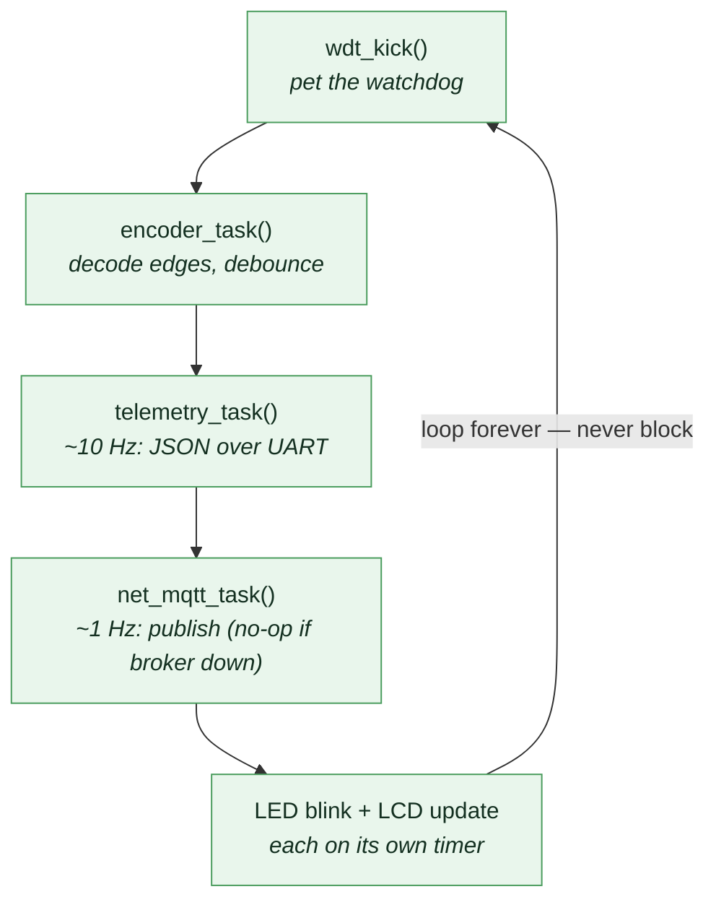
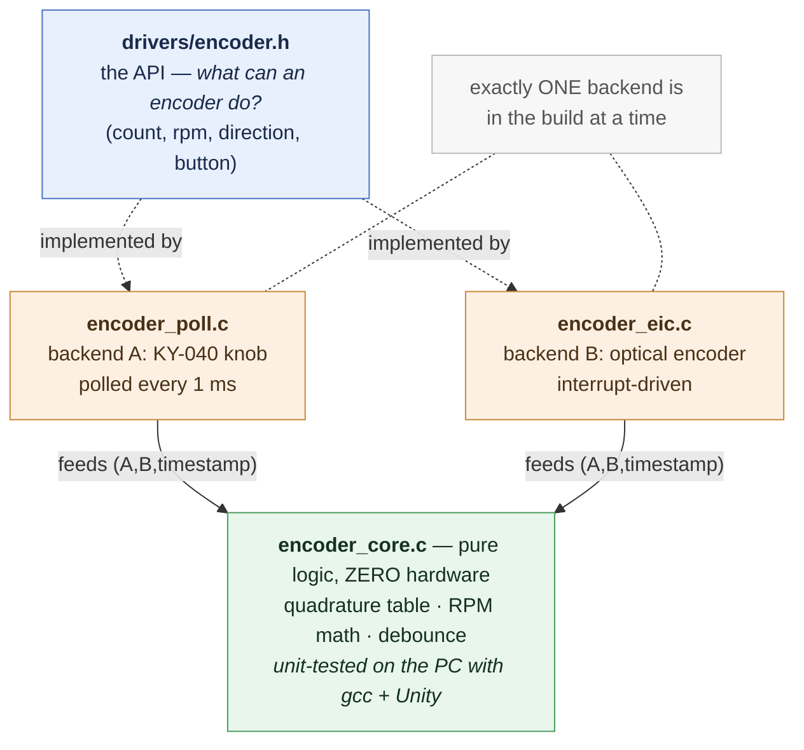

# 2 · Firmware Architecture

> The skeleton. Before any single feature makes sense, you need to understand
> the shape of the program they all live in: a bare-metal superloop driven by a
> 1 ms tick, with every job written as a non-blocking task. This doc explains
> that shape and why it was chosen.

---

## 2.1 No operating system — the "superloop"

There is no RTOS (no FreeRTOS, no threads, no scheduler). The entire program is
one infinite loop that runs each task in turn, forever. This is called a
**bare-metal superloop**, and the heart of it is in
[`app.c`](../SAMD21_Project/src/app/app.c):

```c
for (;;)
{
    now = timebase_ms();

    wdt_kick();          /* pet the watchdog: the loop is alive */
    encoder_task();      /* decode edges, debounce the button, update RPM */
    telemetry_task();    /* ~10 Hz: build the JSON line, send over UART */
    net_mqtt_task();     /* ~1 Hz: publish over MQTT (no-op if the broker is down) */

    /* ...LED blink and LCD update, each on its own timer... */
}
```

Every pass runs the same short tasks in order and comes straight back around —
the watchdog kick at the top is the "we made it all the way round" proof (doc 6):



Why no RTOS? Because we don't need one, and every dependency you don't add is a
whole class of bugs you don't get. An RTOS buys you preemptive multitasking —
the ability for one task to interrupt another mid-execution. We have maybe five
jobs, none of them long, and none of them needs to interrupt another. An RTOS
would add context-switch overhead, stack-per-task RAM cost (precious on 16 KB),
and priority-inversion and deadlock as new failure modes. For this workload it's
all cost, no benefit.

**The rule that makes a superloop work:** *no task is ever allowed to wait.* If
any task blocks — sits in a loop waiting for something — every other task stops
too, because there's no scheduler to switch away. So every task must do its
little bit of work and **return immediately**. This is the single most important
discipline in the whole firmware, and most of the clever bits exist to honour
it.

---

## 2.2 The 1 ms tick: how tasks know what time it is

A superloop needs a clock, so tasks can say "has 100 ms passed since I last
ran?" That clock is a hardware timer, **TC3**, configured to fire an interrupt
every 1 millisecond. Each tick increments a counter. The counter is exposed
through [`timebase.c`](../SAMD21_Project/src/services/timebase.c) as
`timebase_ms()` (milliseconds since boot) and `timebase_us()` (microseconds,
for the fine timing the RPM math needs).

That's the whole timekeeping system: one counter, incremented 1,000 times a
second by an interrupt, read by everyone else.

### The scheduling pattern (and why it's written *exactly* this way)

Every periodic task uses the same idiom. Here's `telemetry_task()`:

```c
void telemetry_task(void)
{
    static uint32_t t_last;
    static bool     started;

    uint32_t now = timebase_ms();
    if (started && ((now - t_last) < TELEMETRY_PERIOD_MS))
    {
        return;                          /* not time yet — leave immediately */
    }
    t_last  = started ? (t_last + TELEMETRY_PERIOD_MS) : now;
    started = true;

    /* ...do the work... */
}
```

Three details here are deliberate, and getting any of them wrong is a classic
embedded bug:

**1. `now - t_last >= PERIOD`, not `now >= t_last + PERIOD`.**
These look equivalent but behave differently when the millisecond counter
*wraps around* (a `uint32_t` of milliseconds overflows back to 0 after ~49
days). Unsigned subtraction `now - t_last` keeps giving the correct elapsed time
across a wrap; `t_last + PERIOD` can overflow and give a wrong comparison. The
subtraction form is wrap-safe. This matters for a device meant to run for months.

**2. `t_last += PERIOD`, not `t_last = now`.**
When it's time to run, we advance the deadline by exactly one period rather than
resetting it to "now." This keeps the *average* rate exact even if the loop was
briefly late getting around to this task — the deadlines don't drift. (For a few
tasks where catching up makes no sense, we use `t_last = now` on purpose; the
code calls those out.)

**3. The `>=` comparison, never `==`.**
If you checked `now - t_last == PERIOD`, you'd require landing on the exact
millisecond. The loop doesn't run at a fixed phase, so you'd miss it and the
task would never fire. `>=` means "at least this long has passed," which is what
you actually want.

> **Takeaway:** this little four-line pattern is the project's scheduler. It
> appears in `telemetry_task`, `net_mqtt_task`, and the LED/LCD blocks in
> `app.c`. Once you can read it fluently, you can read the whole superloop.

---

## 2.3 Interrupts: the one place code *does* run out of band

The superloop handles everything slow and periodic. But some events can't wait
for the loop to come around — an encoder edge at 16,800 edges/second can't be
polled by a loop that runs maybe tens of thousands of times a second but with
jitter. Those are handled by **interrupts** (ISRs — Interrupt Service Routines),
which the hardware runs the instant the event happens, pausing the main loop.

Two interrupts matter:

- **TC3** fires every 1 ms to drive the timebase (and, as doc 5 explains, to
  tick the MQTT keepalive timer).
- **EIC** (External Interrupt Controller) fires on each encoder A/B edge, in the
  *optical-encoder* build — see doc 3 for why the KY-040 knob build polls
  instead.

There's one iron rule for ISRs in this project (and in good embedded code
generally):

> **ISRs only update state or set a flag. They never do real work, never
> `printf`, never block.**

An ISR interrupts the main program. The longer it runs, the longer everything
else is frozen — and if it blocks, the system is dead. So an encoder ISR records
the pin levels and a timestamp and returns; the *interpretation* of that data
happens later, in `encoder_task()`, in the calm of the main loop. A `printf`
from an ISR is the classic beginner mistake: it can take milliseconds and can
re-enter the UART driver that the main loop is also using.

---

## 2.4 The 3-layer encoder design — the project's best structural idea

The encoder code is split into **three layers**, and understanding why is worth
more than any single algorithm in here. The layers:



Read the layers from the outside in:

**`encoder.h` — the contract.** It declares functions like
`encoder_get_count()`, `encoder_get_rpm_x10()`, `encoder_get_direction()`.
Nothing in it mentions pins, interrupts, or a specific sensor. The telemetry
code, the LCD code, and `app.c` only ever call through this header. They have no
idea what kind of encoder is attached.

**The backends — the hardware.** `encoder_poll.c` reads the KY-040's pins every
1 ms from the superloop (a mechanical knob bounces for milliseconds, so polling
beats interrupts — see doc 3). `encoder_eic.c` uses edge interrupts for the fast
optical production encoder. Both implement the exact same `encoder.h` functions.
**Only one is compiled into the build at a time** (they define the same symbols,
so including both would be a link error).

**`encoder_core.c` — the brains, with no hardware at all.** The quadrature state
table, the floor-division for detents/revs, the RPM-from-timestamps math, the
button debounce — all of it is here, in plain C that touches no registers. A
backend feeds it `(A, B, timestamp)` samples; the core does the thinking.

### Why split it this way? Two concrete payoffs.

**1. Swapping the KY-040 knob for the production optical encoder is one new
file.** You write a new backend that implements `encoder.h`, swap it into the
build in place of `encoder_poll.c`, and *nothing else changes* — not the API,
not the core logic, not telemetry, not the app. The expensive, hard-to-get
production encoder doesn't have to exist for the rest of the system to be
finished and tested.

**2. The pure logic can be unit-tested on your laptop.** Because
`encoder_core.c` has no hardware dependencies, it compiles with plain `gcc` and
runs against a **Unity** test suite on the PC (in `SAMD21_Project/tests/`), with
no board attached. You can test "20 detents forward gives +80 counts" or
"a reversal on a skipped state self-corrects" in a millisecond, in a loop, on
every build — things that would be slow and fiddly to verify by turning a real
knob. This is why pure logic is pulled out of hardware files wherever possible;
see doc 3 for the actual tests.

> This is the general lesson: **separate policy from mechanism, and separate
> both from the hardware.** The thing that's hard to test or hard to swap (the
> hardware) gets the thinnest possible layer; the thing you want to test and
> trust (the logic) gets isolated where you can hammer it.

---

## 2.5 Services vs. drivers — the folder split

Two folders divide the non-app code:

- **`drivers/`** — code that talks to a specific chip or device: the LCD
  (`lcd_hd44780.c`), the encoder backends, the W5500 port (`w5500_port.c`).
- **`services/`** — code that provides a capability to the rest of the firmware
  without being tied to one device: timekeeping (`timebase`), the telemetry
  payload builder (`telemetry`), the non-blocking logger (`log`), configuration
  (`config`), the watchdog (`wdt`), and the MQTT client (`net_mqtt`).

The line isn't always razor-sharp, but the intent is: a driver knows about a
datasheet; a service knows about a job. It keeps `app.c` readable — it reads
like a table of contents for the system.

---

## 2.6 The things we deliberately did *not* touch

Two categories of code are off-limits to hand-editing, and knowing why is part
of understanding the architecture:

- **MCC-generated code** (`src/config/default/`). The Microchip Code Configurator
  generates all the low-level peripheral setup (clocks, the TC3 timer, SPI, the
  UART) from a visual tool. If that config needs to change, you change it *in
  MCC and regenerate*, never by hand — because the next regenerate would wipe a
  hand edit. The generated config is the single source of truth for hardware
  setup.
- **Vendored / submodule code** (the W5500 `ioLibrary_Driver`). It's pinned
  external code pulled in as a git submodule. Editing it in place means your
  change silently vanishes the next time the submodule updates. When it needs
  configuring, you do it through the proper seam — a compiler `#define`, an
  include path — never an edit. Doc 4 shows exactly how the W5500 is selected
  this way.

This is a discipline, not a limitation: it keeps the parts you own small and the
parts you don't own replaceable.

---

## 2.7 Where to go next

- The measurement itself: [doc 3, The encoder & the math](03-encoder-and-math.md)
- Straight to networking: [doc 4, Ethernet](04-ethernet-deep-dive.md)
