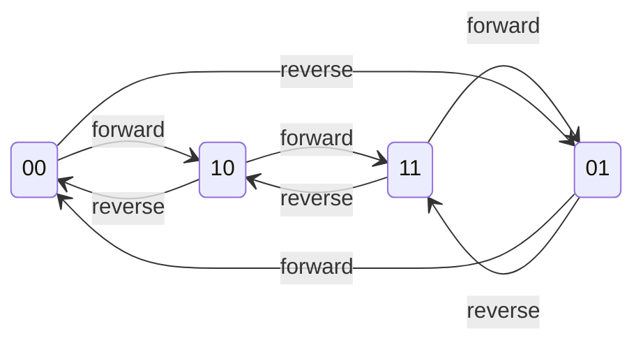

# 3 · The Encoder & The Math

> How two square waves become a feet-per-second number, and why every bit of the
> math is done in integers. This is the measurement core — the reason the device
> exists. All of it lives in
> [`encoder_core.c`](../SAMD21_Project/src/drivers/encoder_core.c), hardware-free
> and unit-tested.

---

## 3.1 What a quadrature encoder actually outputs

Two square-wave signals, **A** and **B**, 90° out of phase. As the shaft turns
one way, A leads B; the other way, B leads A. If you plot them as the shaft
turns forward:

```
        __________              __________
A  ____|          |____________|          |____   
            __________              __________
B  ________|          |____________|          |__
   
   state:  00  10  11  01  00  10  11  01  00
           └── one full quadrature cycle ──┘
```

Treat (A, B) as a 2-bit number — call it the **state**, `A<<1 | B`. As the shaft
turns, the state walks through a repeating sequence: `00 → 10 → 11 → 01 → 00`
one direction, and `00 → 01 → 11 → 10 → 00` the other. **Exactly one bit changes
at each step** — that's the defining property of a *Gray code*, and it's what
makes quadrature robust. The four states form a ring the shaft walks around; the
direction it walks is the direction it turns:



A jump *across* the ring (00↔11 or 01↔10) skips a state — that's the `INV` case
below.

Because there are 4 state changes per cycle, counting *every* edge gives **4×
decoding**: 4 counts per quadrature cycle. The KY-040 bench knob has 20 detents
(clicks) per revolution and one quadrature cycle per detent, so:

```
4 counts/detent × 20 detents/rev = 80 counts/rev
```

The production optical encoder is 600 pulses/rev → 2,400 counts/rev at 4×.

---

## 3.2 Decoding with a state table (not a pile of if-statements)

The naive way to decode is a tangle of "if A rose and B is low, go forward…"
conditionals. The clean way — and what we use — is a **lookup table** indexed by
*where you were* and *where you are now*.

Build a 4-bit index: `(previous_state << 2) | current_state`. That's 16 possible
transitions. Each one is either +1 (forward), −1 (reverse), 0 (no change), or
*invalid*. The whole decoder is this table from
[`encoder_core.c`](../SAMD21_Project/src/drivers/encoder_core.c):

```c
static const int8_t QUAD_TABLE[16] = {
    /* prev=00 */  0,  +1,  -1, INV,
    /* prev=01 */ -1,   0, INV,  +1,
    /* prev=10 */ +1, INV,   0,  -1,
    /* prev=11 */ INV, -1,  +1,   0,
};
```

Decoding one sample is then just:

```c
uint8_t curr = (a << 1) | b;
int8_t  step = QUAD_TABLE[(prev << 2) | curr];
```

Why a table? It's branch-free (fast and constant-time, which matters in an ISR),
it's exhaustive (all 16 cases are visibly handled — you can audit it at a
glance), and it puts the forward/reverse/invalid logic in *data* rather than
*control flow*, which is far easier to reason about and test.

### The diagonal entries: `INV` (invalid)

Look at the entries where **both bits flip at once** — `00→11` and `01→10`.
On a clean quadrature signal that's *impossible* in a single step (only one bit
changes at a time). If you see it, something went wrong: either contact bounce,
or you sampled slower than the shaft was moving and *missed* a state.

What do you do with an impossible transition? The core's answer is subtle and
worth understanding:

```c
if (step == ENCODER_CORE_INVALID_STEP)
{
    e->invalid++;                       /* count it, for diagnostics */
    if (e->direction == 0)
        return;                         /* no known direction — just hold */
    step = (int8_t)(2 * e->direction);  /* assume motion continued: ±2 */
}
```

**The reasoning:** the shaft is a physical object with inertia; it doesn't
teleport. If both bits changed, the shaft really did move two positions — we
just missed the middle one. Dropping the event (counting 0) would permanently
lose those two counts and the total would slowly drift. So instead we assume
motion *continued in the last known direction* and apply ±2. The only time this
guesses wrong is a genuine direction reversal that happens to land exactly on a
skipped sample — rare, and it self-corrects at the next clean detent. "Keep
counting and self-correct" beats "silently lose counts forever."

> This is a judgment call, and it's logged in `CLAUDE.md`'s decisions table so
> nobody re-opens it without a reason. The `invalid` counter is exposed so you
> can *see* how bouncy a given encoder is — on the cheap KY-040 it climbs; on
> the production optical encoder it should stay near zero.

### Seeding: avoiding a bogus first count

When the encoder starts, `prev` has to be initialised to the *actual* current
pin state, or the very first real edge computes a transition from a fictional
`00` and registers a bogus step. `encoder_core_seed()` sets `prev` from the live
pins once at startup. Small detail, but it's the difference between starting at
0 and starting at −1.

---

## 3.3 Counts → detents and revolutions (and the floor-division trap)

Counts are the raw unit. Humans want detents and revolutions:

```c
detents     = count / counts_per_detent;   // 4
revolutions = count / counts_per_rev;      // 80
```

Easy — until the count goes negative (shaft turned backwards past zero). Here's
the trap: **C's integer division truncates toward zero**, so `-1 / 80 == 0`. But
−1 count is *below* zero revolutions; it should floor to −1, not round up to 0.
Truncation would make the revolution count jump between 0 and 0 around the
origin and lose a revolution on the way down.

So the core uses explicit **floor division**:

```c
static int32_t floor_div(int32_t n, int32_t d)
{
    int32_t q = n / d;
    if ((n % d != 0) && ((n < 0) != (d < 0)))  /* result should be negative */
        q--;                                     /* and didn't divide evenly */
    return q;
}
```

It does the normal division, then nudges down by one when the true result is
negative and there was a remainder. This is the kind of bug that passes every
test you run turning the knob *forwards* and only bites when someone turns it
back past the start. It's in the decisions log for that reason.

---

## 3.4 RPM: averaging edge timestamps

Speed is "distance over time." We have the distance (counts); we need the time.
The approach: **timestamp each edge** (in microseconds, from `timebase_us()`)
into a small **ring buffer**, and measure the time span across the buffer.

```c
e->edge_us[e->edge_head] = us;                 /* record this edge's time   */
e->edge_head = (e->edge_head + 1) % SLOTS;      /* advance, wrapping around  */
```

Then RPM is computed from the span of the oldest-to-newest timestamps:

```
us_per_count = span_us / (number_of_intervals)
rev/s        = 1e6 / (counts_per_rev × us_per_count)
rpm          = rev/s × 60
```

Two design choices to understand:

**Why average over a ring instead of just timing the last gap?** A single gap is
noisy — especially at low speed and especially on a bouncy knob. Averaging over
the last several edges smooths that out while still responding quickly. The ring
is small, so it "forgets" old data fast enough to track real speed changes.

**Why microsecond resolution?** At the production target (600 PPR, 420 RPM),
edges arrive roughly every **60 microseconds**. Millisecond timestamps would be
far too coarse — you'd be rounding a 60 µs interval to 0 or 1 ms and the RPM
would be garbage. Microseconds give the resolution the fast case needs.

**The stop timeout.** If no edge arrives for a configured time (≈1 second), the
shaft has stopped: RPM is forced to 0 *and direction is cleared to 0*.

```c
if (!e->have_edge || ((now_us - e->last_edge_us) >= e->cfg.stop_timeout_us))
{
    e->rpm_x10   = 0U;
    e->direction = 0;        /* don't show a direction on a stopped shaft */
    return;
}
```

Why clear direction? Because a dashboard showing "forward" on a shaft that's
been still for ten seconds is lying. Stopped means stopped — no speed, no
direction. (Decisions log, again.)

---

## 3.5 Why there is no floating point *anywhere*

You'll notice RPM is stored as `rpm_x10` — an integer holding RPM × 10 — and
speed as milli-feet/second, and `feet_per_rev` as an integer × 1000. Never a
`float`, never a `double`, never `%f` in a `printf`.

This is deliberate and it's a real embedded gotcha. The SAM D21's Cortex-M0+ has
**no hardware floating-point unit**. The moment you use `%f` in a `printf`, the
XC32 compiler links in a large software floating-point formatting library — kilobytes
of flash, on a part where flash is finite, for the "convenience" of printing a
decimal point.

The fix is **fixed-point integer arithmetic**: keep the number scaled up by a
known power of ten, do all math in integers, and only split it into
"whole.fraction" at the last moment when building a string. Here's the whole
trick, from [`telemetry.c`](../SAMD21_Project/src/services/telemetry.c):

```c
/* rpm_x10 holds RPM×10. Print it as "<whole>.<tenths>" with plain integers: */
snprintf(buf, len, "\"rpm\":%lu.%lu",
         (unsigned long)(r10 / 10U),      /* whole part  */
         (unsigned long)(r10 % 10U));     /* tenths part */
```

Divide by 10 for the whole part, mod 10 for the fraction. No float ever exists.
The same pattern prints speed to three decimals (scaled ×1000). This keeps the
binary small and the math exact and deterministic — no rounding surprises.

---

## 3.6 Counts → feet: the measurement that actually matters

The customer doesn't care about counts or RPM; they care about **feet of
material per second**. The conversion, in
[`telemetry.c`](../SAMD21_Project/src/services/telemetry.c):

```
ft/s      = (rpm / 60) × feet_per_rev
total_ft  = revolutions × feet_per_rev
```

`feet_per_rev` is the bridge from "shaft turns" to "material feet." Here's the
honest part, and a good customer-facing teaching point: **we can estimate it
from the sprocket geometry, but we can't trust that estimate.** The shaft drives
a chain, which drives *something* downstream — a puller, a capstan, rollers —
with its own ratio and some slip. The real `feet_per_rev` has to be **calibrated
on the actual machine**: mark the material, run N revolutions, measure the feet
that came out, divide.

So `feet_per_rev` lives in `services/config.c` as a configurable value (a
placeholder of 1.000 for now; headed for NVM storage and a UART command in phase
P5), **not** baked into the sensor driver. The sensor measures shaft motion; the
*configuration* knows the machine. Keeping those separate is why one firmware
image works on any machine once calibrated.

---

## 3.7 The button: debouncing a mechanical switch

The encoder knob also has a push-button, and mechanical switches **bounce** —
one physical press produces a burst of electrical open/close transitions over a
few milliseconds. Count them raw and one press looks like five. The debounce in
`encoder_core_button_tick()` (called once per millisecond) is a classic
*stability timer*:

```c
if (raw_pressed != e->btn_candidate) {   /* level changed: restart the timer */
    e->btn_candidate = raw_pressed;
    e->btn_count_ms  = 0U;
}
else if (e->btn_candidate != e->btn_stable) {
    if (++e->btn_count_ms >= e->cfg.debounce_ms) {
        e->btn_stable = e->btn_candidate;   /* new level held long enough: accept */
        if (e->btn_stable) e->btn_events++; /* count a press on 0→1 */
    }
}
```

The idea: a new level must *hold steady* for `debounce_ms` before it's believed.
Bounce transitions keep resetting the timer, so they never get accepted; only a
real, sustained press does. One press → one counted event.

---

## 3.8 Is the SAM D21 fast enough? (the arithmetic)

A fair question for a Cortex-M0+ at 48 MHz with no quadrature hardware. The
decode runs in an ISR costing ~4 µs per edge:

| Case | Edge rate | CPU load |
|---|---|---|
| 600 PPR @ 7 ft/s (420 RPM) — **the target** | ~16,800/s | **~7%** |
| 600 PPR @ 2× headroom (840 RPM) | ~33,500/s | ~13% |
| 1000 PPR @ 3000 RPM | 200,000/s | **not feasible** |

The target sits at 7% with huge headroom. The ceiling is around 50,000 edges/s;
above that (very high PPR or very high RPM) you'd offload counting to a dedicated
quadrature counter chip (an **LS7366R**) or move to a **SAM E5x** part, which
*does* have a hardware quadrature decoder (the PDEC peripheral). Knowing where
your ceiling is — and what you'd reach for past it — is the mark of having
actually done the engineering rather than hoping.

---

## 3.9 This is why the logic is unit-tested

Everything above — the state table, the ±2 recovery, floor division, the RPM
math, the debounce — is **pure logic with no hardware**. That's not an accident;
it's so it can be tested on your laptop with `gcc` + Unity, no board required.
The test suite in `SAMD21_Project/tests/` encodes the acceptance criteria
directly:

- 20 detents forward → count +80, detents +20, revolution +1
- 20 back → count returns to 0
- a count at rest is always a multiple of 4
- one button press → exactly one event
- RPM reads 0 within ~1 second of stopping
- the ±2 invalid-recovery keeps the count correct through a skip

These run in milliseconds and catch regressions the instant you introduce them —
including the negative-number floor-division bug, which no amount of turning the
knob forwards would ever reveal. That payoff is the entire reason doc 2 harped
on pulling pure logic out of the hardware.

---

## 3.10 Where to go next

- The networking stack starts here: [doc 4, Ethernet](04-ethernet-deep-dive.md)
