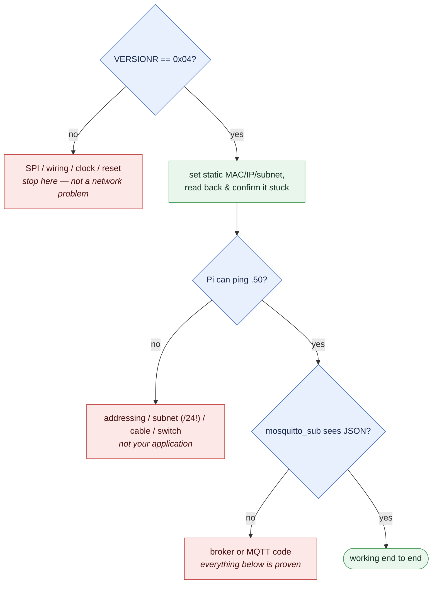

# 4 · Ethernet Deep Dive

> The big one. You told me networking is the weak spot, so this doc starts from
> the wire and builds up — what Ethernet *is*, what TCP/IP *is*, what a socket
> *is* — and only then shows how the W5500 does all of it in hardware and how
> our code drives it. Take it slowly; it's long on purpose.
>
> By the end you should be able to answer: *"When the node sends a reading to the
> Pi, what actually happens, layer by layer?"*

---

## 4.1 The mental model: networking is layers

The single most useful idea in all of networking is that it's built in
**layers**, each one using the layer below it and not caring how that layer
works inside. You already use this idea in firmware (the 3-layer encoder in
doc 2 is the same thought). For networking the canonical stack is:

```
   ┌─────────────────────────────────────────────┐
   │  Application   │  MQTT  (our messages)        │   "what do I want to say?"
   ├─────────────────────────────────────────────┤
   │  Transport     │  TCP   (reliable byte stream)│   "get it there, in order, intact"
   ├─────────────────────────────────────────────┤
   │  Internet      │  IP    (addresses + routing) │   "which machine, across networks?"
   ├─────────────────────────────────────────────┤
   │  Link          │  Ethernet (frames on a wire) │   "put bits on this physical cable"
   └─────────────────────────────────────────────┘
```

A message starts at the top (MQTT: "here's a telemetry reading") and travels
**down** the stack, each layer wrapping it in its own header, until it's
electrical signals on the Cat6 cable. At the Raspberry Pi it travels back **up**,
each layer unwrapping its header, until Mosquitto receives the original MQTT
message. This wrapping is called **encapsulation**, and it's the whole game:

```
            ┌──────────────────────── on the wire ────────────────────────┐
  Ethernet: │ Eth header │ IP header │ TCP header │  MQTT bytes  │ Eth CRC │
            └──────────────────────────────────────────────────────────────┘
             └── Link ──┘ └─ Internet┘ └Transport┘ └Application─┘
```

Each layer only reads *its own* header and treats everything inside as an opaque
blob it doesn't need to understand. That's what lets you swap MQTT for HTTP
without touching Ethernet, or run over Wi-Fi instead of copper without touching
TCP.

The rest of this doc walks these four layers from the bottom up, then shows
where the W5500 fits (spoiler: it does the bottom three for you), then reads our
actual code.

---

## 4.2 Layer 1 — Ethernet: bits on a wire, and MAC addresses

**Ethernet** is the bottom layer: the physical cable (Cat6 here), the voltages,
and the rule for how one device hands a chunk of data to another device *on the
same local network*.

The unit of data at this layer is a **frame**. Every Ethernet device has a
**MAC address** — a 6-byte number burned in at the factory (e.g.
`02:00:00:00:00:01`), globally unique, identifying *that specific piece of
hardware*. A frame says, in effect, "from MAC X, to MAC Y, here are the bytes."

Key point: **MAC addresses only work on the local network segment.** A frame
with a destination MAC gets delivered to that one device on the local wire by
the switch. Ethernet has no concept of "another network across town" — that's
IP's job, one layer up. Ethernet is purely "get this frame to a device on *this*
wire."

A couple of facts that matter for our project:

- **The W5500 has no MAC address of its own.** Unlike a laptop's Ethernet chip,
  it ships blank — you must *give* it one. In
  [`w5500_port.c`](../SAMD21_Project/src/drivers/w5500_port.c) we hardcode one:
  ```c
  static const uint8_t NODE_MAC[6] = { 0x02, 0x00, 0x00, 0x00, 0x00, 0x01 };
  ```
  The `0x02` first byte is deliberate: it marks the address as
  *locally administered* (bit 1 set) and *unicast* (bit 0 clear). That's the
  range reserved for "addresses an administrator made up," as opposed to ones a
  manufacturer bought. **You must make this unique per node** before putting two
  on the same LAN — two identical MACs on one wire is a nasty, intermittent bug.
  (A proper design reads a unique MAC from a tiny EEPROM chip; the wiring doc
  reserves one for later.)

- **A switch** (doc 1's "field switch") is a pure Ethernet-layer device. It
  learns which MAC lives on which physical port and forwards frames accordingly.
  It doesn't understand IP at all. That's why doc 1 says "switches, not a
  router" — everything is on one local segment, so plain Ethernet switching is
  all the delivery you need.

---

## 4.3 Layer 2 — IP: addresses that span networks

Ethernet gets a frame across one wire. **IP (Internet Protocol)** is how you
address a machine that might be on a *different* network, reachable only by
hopping through routers. Its unit is a **packet**, and its addressing is the
familiar **IP address** — `192.168.1.50`.

The crucial difference from a MAC address:

| | MAC address | IP address |
|---|---|---|
| Assigned by | the factory (fixed) | you / your network (configurable) |
| Scope | one local wire | the whole internetwork |
| Analogy | a specific person | a mailing address |

Our IP plan (from the wiring/overview docs):

```
Node (this device):   192.168.1.50
Pi broker:            192.168.1.5
Subnet mask:          255.255.255.0   (written "/24")
Gateway:              192.168.1.1
```

### Subnet masks and why `/24` nearly cost an afternoon

This is the single most important networking concept to actually *get*, because
getting it wrong produced one of this project's real bugs.

The **subnet mask** splits an IP address into a *network part* and a *host
part*. `255.255.255.0` — written `/24` because the first 24 bits are 1s — means
"the first three numbers are the network; the last number is the host."

So with a `/24` mask, `192.168.1.50` and `192.168.1.5` are on the **same
network** (both `192.168.1.x`). A device decides "is this destination local, or
do I send it to the gateway?" purely by applying its mask:

```
my IP:     192.168.1.50
dest IP:   192.168.1.5
mask /24:  255.255.255.0
                ↓ compare network parts
   192.168.1   ==   192.168.1    →  SAME network: talk directly over Ethernet
```

Now the bug. When the Raspberry Pi was first configured over a direct cable, a
bad `nmcli` command left its address as `192.168.1.5/32`. A `/32` mask means
"the network is *only this one address*" — the Pi believed it was the sole
machine on its entire network. So when asked to reach `192.168.1.50`, it
concluded "that's not local, and I have no gateway," and the request **never
left the Pi**. Ping: 100% loss. The fix was one character — `/32` → `/24`:

```bash
nmcli con mod node-link ipv4.addresses 192.168.1.5/24   # the /24 is everything
```

> **Lesson for customer sites:** the mask has to be right, and *consistent*,
> across every device on the segment. A direct cable between two devices has no
> DHCP server to hand out addresses, so you set them statically — and a wrong
> mask fails in a way that looks like a hardware or wiring problem but isn't.
> This is logged in `CLAUDE.md`'s decisions table and gotchas because it's
> exactly the kind of thing that eats an afternoon.

### ARP: the glue between IP and MAC

One more piece, because it explains the previous bug fully. To actually *send*
to a local IP, a device needs that IP's **MAC address** (remember: Ethernet
delivers by MAC, not IP). It finds it with **ARP (Address Resolution
Protocol)**: it broadcasts "who has 192.168.1.5? tell me your MAC," and the
owner replies. But a device only ARPs for addresses it believes are *local*.
With the `/32` mask, the Pi never believed `.50` was local, so it never even
sent the ARP — which is why the request never hit the wire. The W5500 handles
ARP for us automatically; this is just so you understand what's happening
underneath.

---

## 4.4 Layer 3 — TCP: turning packets into a reliable stream

IP packets can arrive out of order, be duplicated, or vanish entirely — IP makes
no promises. **TCP (Transmission Control Protocol)** builds a reliable,
ordered, two-way **byte stream** on top of that unreliable packet delivery. When
you "open a TCP connection," you get something that behaves like a clean pipe:
whatever bytes you put in one end come out the other end, once each, in order —
TCP handles retransmitting lost packets, reordering, and discarding duplicates
for you.

TCP adds two concepts:

- **Ports.** An IP address identifies a *machine*; a port identifies a
  *service* on that machine. The MQTT broker listens on **port 1883**. So
  "connect to `192.168.1.5:1883`" means "the MQTT service on the Pi." Ports are
  how one machine runs many services at once.

- **The connection, and the handshake.** Before any data flows, TCP does a
  **three-way handshake** to establish the connection:
  ```mermaid
  sequenceDiagram
      participant N as Node
      participant P as Pi (broker)
      N->>P: SYN  — "I'd like to connect"
      P-->>N: SYN-ACK  — "OK, and I'd like to connect back"
      N->>P: ACK  — "confirmed"
      Note over N,P: connection open — bytes flow both ways
  ```
  This round-trip is why connecting takes *time* and can *fail* (if the other
  end isn't there, the SYN gets no answer). Hold onto that — it's the root of a
  real bug in doc 6, where a blocking connect attempt nearly reset-looped the
  node because the handshake took longer than the watchdog allowed.

TCP is why MQTT can just say "send these bytes" and trust they arrive. The
reliability we lean on at the top is manufactured here.

---

## 4.5 Layer 4 — the socket: the API over all of the above

A **socket** is the programming abstraction that bundles layers 2–3 into
something you call like a function. "Open a socket to 192.168.1.5:1883" sets up
the IP addressing and the TCP handshake; "write to the socket" pushes bytes into
the stream; "read from the socket" pulls them out. On a PC the socket is
provided by the operating system. **On our MCU, the socket is provided by the
W5500 chip** — which is the whole point of the next section.

---

## 4.6 The W5500: all of that, in silicon

Here's the payoff. Everything in 4.2–4.5 — Ethernet framing, IP addressing and
ARP, the TCP handshake and retransmission, sockets — is *work*. On a normal
microcontroller you'd run a **software TCP/IP stack** like **lwIP** to do it, and
that costs you:

- **RAM:** tens of KB for buffers and connection state. Our SAM D21 has **16 KB
  total.** lwIP would dominate it.
- **CPU:** checksums, timers, retransmission logic, all competing with the
  encoder ISR.
- **Complexity:** lwIP is thousands of lines of code to configure, understand,
  and debug.

The **W5500** is a different approach: a chip with the **entire TCP/IP stack
built into hardware** ("hardwired TCP/IP"). It has 8 independent sockets, 32 KB
of its own buffer RAM, and does Ethernet/IP/TCP/UDP itself. Your MCU doesn't run
a stack at all. It just reads and writes the W5500's **registers** over SPI:

```
   What you want                     What you do to the W5500
   ─────────────                     ────────────────────────
   "my IP is 192.168.1.50"      →    write 4 bytes to the SIPR register
   "open a TCP socket"          →    write a command byte to socket 1's CR
   "connect to 192.168.1.5:1883"→    write the dest IP/port regs, send CONNECT
   "send these bytes"           →    copy bytes into the socket TX buffer, SEND
   "any data arrived?"          →    read the socket RX byte-count register
```

From the firmware's side, the entire internet is a set of registers reachable
over a 4-wire SPI bus. That trade — a few dollars of extra silicon in exchange
for not running a TCP stack on a 16 KB part — is **the** defining architectural
decision of this project.

```
   ┌──────────────┐   SPI (4 wires)   ┌───────────────────────────┐   RJ45
   │   SAM D21     │ ◄───────────────► │          W5500            │ ◄──────► network
   │              │  MOSI/MISO/SCK/CS │                           │   (Cat6)
   │ reads/writes │                   │  Ethernet MAC + PHY       │
   │  registers,  │                   │  IP + ARP                 │
   │ no TCP stack │                   │  TCP/UDP + 8 sockets      │
   │              │                   │  32 KB buffers            │
   └──────────────┘                   └───────────────────────────┘
         ▲                                        ▲
    runs MQTT only                       runs everything below MQTT
```

---

## 4.7 SPI: the 4 wires between the MCU and the W5500

**SPI (Serial Peripheral Interface)** is the simple, fast synchronous bus the
MCU uses to reach the W5500. Four wires:

| Wire | Meaning | Our pin |
|---|---|---|
| **MOSI** | Master Out, Slave In — MCU → W5500 | PA16 |
| **MISO** | Master In, Slave Out — W5500 → MCU | PA19 |
| **SCK** | Clock — the MCU drives it, both ends sample on its edges | PA17 |
| **CS** | Chip Select — pull low to say "I'm talking to *you*" | PA18 |

SPI is **full-duplex and clocked by the master**: every clock pulse, a bit goes
out on MOSI and a bit comes in on MISO simultaneously. There's no baud-rate
negotiation (unlike a UART) — the clock *is* the timing. We run it at **2 MHz**,
"mode 0" (a convention for which clock edge samples data), blocking (the MCU
waits for each byte — fine at 2 MHz for bring-up).

**Chip Select** is worth a sentence: it lets multiple chips share the MOSI/MISO/SCK
wires, with CS picking which one is active. We hold CS **low for an entire W5500
frame** and raise it when done. Our wiring uses a plain GPIO for CS (not the
SPI peripheral's automatic hardware CS), so the port code toggles it manually.

---

## 4.8 Reading the port layer: `w5500_port.c`

Now the code makes sense. [`w5500_port.c`](../SAMD21_Project/src/drivers/w5500_port.c)
is the **thin glue** between the vendor's `ioLibrary_Driver` and *our* specific
SPI peripheral and pins. The library knows the W5500's register protocol; it
does **not** know it's talking over SERCOM1 on a SAM D21. So it calls back into
our code for the raw byte moves. We hand it four callbacks:

```c
static void cs_select(void)   { ETH_CS_Clear(); }    /* CS low  = "talking to you" */
static void cs_deselect(void) { ETH_CS_Set();   }    /* CS high = idle             */

static uint8_t spi_read_byte(void) {                 /* clock out a dummy, read one in */
    uint8_t tx = 0xFF, rx = 0;
    SERCOM1_SPI_WriteRead(&tx, 1, &rx, 1);
    return rx;
}
static void spi_write_byte(uint8_t b) { SERCOM1_SPI_Write(&b, 1); }
```

Then at init we *register* those callbacks with the library and bring the chip
up:

```c
reg_wizchip_cs_cbfunc(cs_select, cs_deselect);        /* "here's how to toggle CS" */
reg_wizchip_spi_cbfunc(spi_read_byte, spi_write_byte);/* "here's how to move a byte" */
```

This callback pattern is the same "separate mechanism from policy" idea as the
encoder's 3-layer split: the library owns the *protocol*, our port owns the
*hardware*, and the two meet at four function pointers. Port the whole thing to
a different MCU and you rewrite only these four functions.

### The reset dance, and why the timing is in the datasheet

The W5500 needs a specific power-up ritual, and the exact numbers come straight
from the datasheet (not guesses):

```c
ETH_RST_Clear();   /* pull reset low   */
delay_us(600);     /* hold ≥500 µs (datasheet t_RST) — we use 600 for margin */
ETH_RST_Set();     /* release reset    */
delay_ms(2);       /* wait ≥1 ms for the PHY to come up — 2 ms for margin   */
```

Then `wizchip_init()` sets up the socket buffer sizes (2 KB per socket × 8). Get
the reset timing wrong and the chip comes up in an undefined state that *looks*
like a wiring fault — so we follow the datasheet exactly and leave generous
margins, because this runs once at boot and the extra microseconds cost nothing.

---

## 4.9 Bring-up milestone 1: `VERSIONR == 0x04`

How do you prove the SPI wiring, clock, chip, and reset are all correct *before*
chasing network problems? The W5500 has a version register that **always reads
`0x04`** on a healthy chip:

```c
uint8_t w5500_version(void) { return getVERSIONR(); }   /* expect 0x04 */
```

In [`app.c`](../SAMD21_Project/src/app/app.c) that's the first network thing we
do:

```c
printf("W5500 VERSIONR = 0x%02X (expect 0x04)\r\n", ver);
```

This one byte is a brilliant, cheap sanity check. If it reads `0x04`, your SPI
plumbing is *provably* working end to end — the right clock, the right mode, CS
toggling correctly, the chip alive. If it reads `0x00` or `0xFF`, you have a
wiring/SPI problem and *zero* reason to look at IP addresses yet. Always find the
smallest possible "is the hardware even alive?" test and pass it first. (On the
real hardware this read `0x04` — see `CLAUDE.md`'s P3 status.)

---

## 4.10 Bring-up milestone 2: a static IP and a ping

With SPI proven, we give the chip its network identity (`w5500_net_up()`):

```c
wiz_NetInfo info = { 0 };
/* copy in NODE_MAC, NODE_IP (.50), NODE_SUBNET (/24), NODE_GATEWAY */
info.dhcp = NETINFO_STATIC;        /* static IP: a direct cable has no DHCP server */
wizchip_setnetinfo(&info);
```

Why **static** and not DHCP? Two reasons. On a direct cable (bench bring-up)
there's no DHCP server to hand out an address at all. And in the plant, a node's
address must never change — `node01` is always `.50` so you always know which
machine a reading came from. (If the plant LAN *does* have DHCP, a DHCP
*reservation* gives the same stability; that's an open deployment question in
`CLAUDE.md`.)

Then a defensive touch — read the config back and confirm it stuck:

```c
wizchip_getnetinfo(&check);
for (int i = 0; i < 4; i++)
    if (check.ip[i] != NODE_IP[i]) return false;   /* the write didn't take */
```

This proves the config write actually reached the chip *before* you go hunting
for a missing ping at the Pi. Cheap proof beats blind faith. **Milestone 2
passes when the Pi can `ping 192.168.1.50` with 0% loss** — which, once the
`/32`→`/24` mask bug was fixed, it did (`CLAUDE.md` P3).

Notice the ordering of the whole bring-up: **chip alive (VERSIONR) → network
identity (static IP) → reachable (ping) → *then* MQTT.** Each step proves one
layer before the next is attempted. When something breaks, you know exactly
which layer to look at — the failure can only be in the step you just added:



This staged approach is the single best habit in network bring-up.

### One line that belongs to doc 6, flagged here

You'll see this in `w5500_net_up()`:

```c
setRTR(2000U);   /* retransmission timeout: 2000 × 100µs = 200 ms */
setRCR(3U);      /* retry count: 3 */
```

That shortens how long the W5500's TCP tries to retransmit before giving up on a
dead peer (~0.8 s instead of the default ~1.8 s). *Why* that specific number
matters is a watchdog story — it's told in full in [doc 6](06-robustness.md).
It's here so you know where the knob lives.

---

## 4.11 How the W5500 is selected without editing the library

The `ioLibrary_Driver` supports several WIZnet chips (W5100, W5500, W6300…). It
has to be told *which* one, and here's the subtle part: it's told through the
**build configuration**, never by editing the library source.

The library header defaults to the wrong chip:

```c
#ifndef _WIZCHIP_
#define _WIZCHIP_   W6300        /* the library's default — not ours */
#endif
```

and the W5500 driver body is wrapped in `#if (_WIZCHIP_ == 5500)`. So if you
*don't* define `_WIZCHIP_=W5500` project-wide, two things go wrong: the header
configures a W6300, and `w5500.c`'s functions compile to nothing — you get
`undefined reference to WIZCHIP_WRITE/READ` at link time. The fix is a project
**preprocessor define**, set in the MPLAB project, not a source edit:

```
_WIZCHIP_=W5500
```

Plus the right **include directories** on the project path (the library is split
across `Ethernet/`, `ioLibrary_Driver/`, and later the MQTT folders). This is the
"configure vendored code through its proper seam, never by editing it" rule from
doc 2, made concrete:

> **The two failure signatures, worth memorising:**
> - *"No such file"* → a missing **include directory** (the compiler can't find
>   a header).
> - *"undefined reference"* → a missing **`.c` in the build**, or a missing
>   `#define` that `#if`'d the code out.
>
> Adding files to the project and adding include paths are **two separate
> steps** in MPLAB. Both are logged in `CLAUDE.md` because they cost real time.

---

## 4.12 What you now know

Trace a single telemetry reading from the node to the Pi and you can name every
layer it passes through:

1. MQTT builds a message (doc 5).
2. It's written to a **socket** on the W5500.
3. The W5500 wraps it in a **TCP** segment (reliable stream, port 1883),
4. inside an **IP** packet (from `.50` to `.5`, same `/24` so delivered locally),
5. inside an **Ethernet** frame (from the node's MAC to the Pi's MAC, resolved by
   ARP),
6. clocked out over **SPI** from the MCU to the W5500, then out the **RJ45** as
   electrical signals on the Cat6,
7. through the **switch** to the Pi, back up the same stack in reverse, and
   delivered to **Mosquitto** as the original MQTT message.

The MCU only ever consciously did step 1 and "write to a socket." The W5500 did
2–6. That's the whole value proposition.

---

## 4.13 Where to go next

- What the node actually *says* over that connection, and the pub/sub model:
  [doc 5, MQTT deep dive](05-mqtt-deep-dive.md)
- The watchdog story behind `setRTR`/`setRCR` and the lazy connect:
  [doc 6, Robustness](06-robustness.md)
