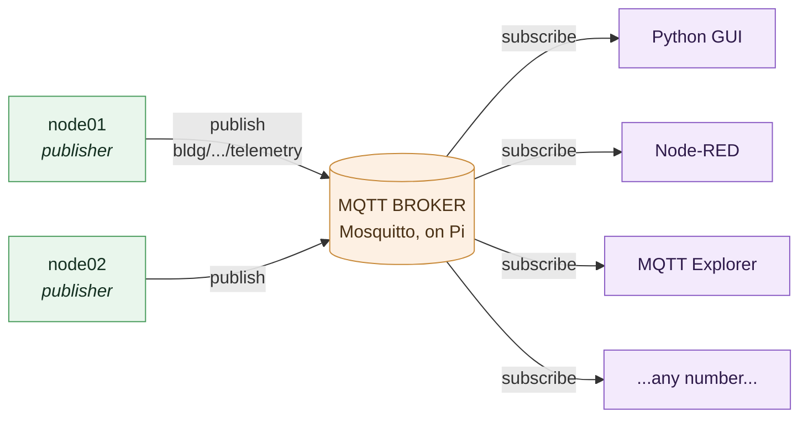
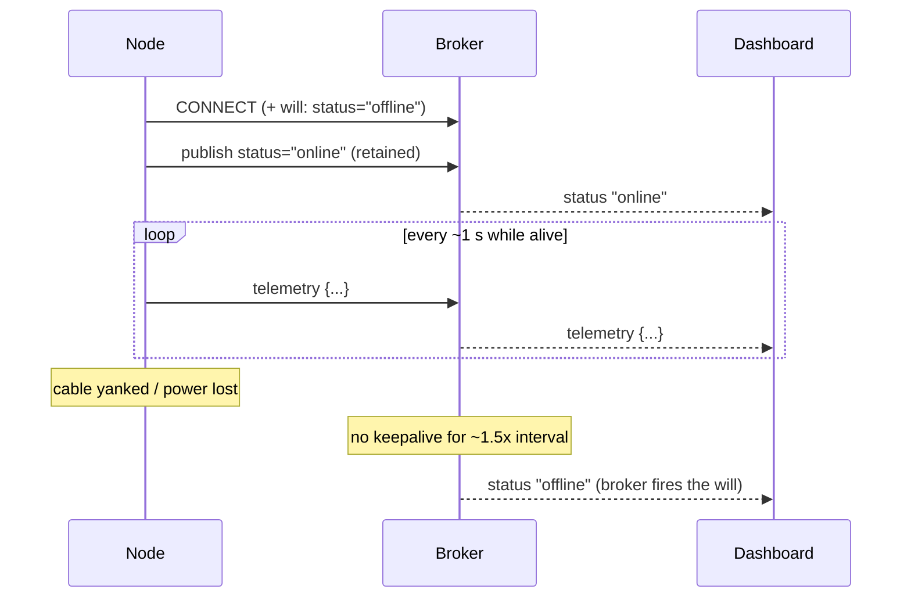

# 5 · MQTT Deep Dive

> Doc 4 got bytes reliably from the node to the Pi. This doc is about *what* the
> node says and *why MQTT is the right language for it*. We build up the model
> — broker, publish/subscribe, topics, QoS, retained messages, last-will — then
> read [`net_mqtt.c`](../SAMD21_Project/src/services/net_mqtt.c) line by line.

---

## 5.1 Why not just HTTP?

The instinct is "the node POSTs its reading to a server." That's HTTP, and it's
the wrong tool here. Watch what goes wrong as the system grows:

- **HTTP is pull/request-response and point-to-point.** The node would have to
  know every dashboard's address and POST to each one. Add a dashboard →
  reconfigure every node. That doesn't scale.
- **Who initiates?** If dashboards poll the node, they hammer a tiny MCU with
  requests; if the node pushes, it needs a list of who's listening. Either way
  the node is coupled to its consumers.
- **Overhead.** An HTTP request is hundreds of bytes of headers to carry a
  60-byte reading, many times a second, from many nodes.

**MQTT** was designed for exactly this situation — many constrained devices
sending small, frequent messages to many consumers — and it solves it with one
idea: a **broker** in the middle, and **publish/subscribe**.

---

## 5.2 The broker and pub/sub: the core model



The publishers (left) and subscribers (right) never know about each other — the
broker in the middle is the only thing either side talks to.

- A **broker** is a server whose only job is to receive messages and route them.
  Mosquitto, running on the Raspberry Pi, is ours.
- A **publisher** sends a message to a **topic** (a named channel). It does *not*
  know or care who, if anyone, is listening.
- A **subscriber** tells the broker "send me everything on this topic." It does
  not know or care who published.
- The broker **decouples** the two. The node publishes to a topic; the broker
  fans that message out to every current subscriber.

The payoff: the node is written **once** and never changes as you add, remove,
or reconfigure dashboards. It publishes one reading a second into the void. Ten
dashboards or zero — the node's job is identical. *That* is why MQTT, not HTTP.

---

## 5.3 Topics: the addressing scheme

A **topic** is a hierarchical string, like a file path. Ours:

```
bldg/extrusion/node01/telemetry      ← the JSON readings, ~1 Hz
bldg/extrusion/node01/status         ← "online" / "offline" presence
   │       │       │       │
  site    area   node    kind
```

The hierarchy is a deliberate design, not decoration. It means a dashboard can
subscribe narrowly or broadly using **wildcards**:

- `bldg/extrusion/node01/telemetry` — just this node's readings.
- `bldg/extrusion/+/telemetry` — every node in the extrusion area (`+` = one
  level).
- `bldg/#` — absolutely everything in the building (`#` = all remaining levels).

So the office dashboard for the extrusion line subscribes to
`bldg/extrusion/+/telemetry` and automatically picks up `node02`, `node03`… the
day they're installed, with no reconfiguration. Designing the topic tree well up
front is what makes that free later. The node builds its topics from its
configured `area` and `node_id` (headed for NVM in P5):

```c
snprintf(s_topic,        sizeof s_topic,        "bldg/%s/%s/telemetry", config_area(), config_node_id());
snprintf(s_status_topic, sizeof s_status_topic, "bldg/%s/%s/status",    config_area(), config_node_id());
```

---

## 5.4 QoS: how hard the broker tries to deliver

MQTT offers three **Quality of Service** levels for delivery:

| QoS | Guarantee | Cost |
|---|---|---|
| **0** | "at most once" — fire and forget, no acknowledgement | cheapest |
| 1 | "at least once" — retried until acked (may duplicate) | more traffic + state |
| 2 | "exactly once" — a 4-step handshake | most expensive |

We publish telemetry at **QoS 0**. Why the cheapest? Because the data is a
**continuous stream of the current speed, once a second.** If one reading is
lost, another is 1 second behind it with the newer value — a dropped sample is
simply irrelevant. Paying QoS 1 or 2's overhead (acknowledgements, stored state,
handshakes) to guarantee delivery of a number that's about to be superseded
would be wasted effort. **Match the QoS to the data's meaning:** streaming
telemetry → QoS 0; a one-off command you must not lose → QoS 1 or 2.

---

## 5.5 Retained messages: solving "the dashboard that connects late"

Normal MQTT is "live": you only receive messages published *after* you
subscribe. That's fine for the 1 Hz telemetry stream (you get the next reading
in a second). But it's a problem for **presence** — "is this node online?" If a
dashboard connects and the node last said "online" an hour ago, the dashboard
hears *nothing* and has no idea of the current state until something changes.

A **retained message** fixes this. When you publish with the retain flag, the
broker **keeps the last retained message on that topic** and delivers it
immediately to anyone who subscribes later. So we publish presence retained:

```c
MQTTMessage status;
status.retained   = 1;                       /* broker keeps this as the topic's "current value" */
status.payload    = (void *)STATUS_ONLINE;   /* "online" */
status.payloadlen = sizeof(STATUS_ONLINE) - 1U;   /* no trailing NUL on the wire */
MQTTPublish(&s_client, s_status_topic, &status);
```

Now any dashboard, connecting at any time, instantly learns the node's current
presence from the retained message — no waiting for the next change. (We do
*not* retain the telemetry itself: a retained reading would show a stale speed
to a late subscriber, worse than showing nothing until the next live reading a
second later.)

---

## 5.6 Last-will: detecting a node that dies without saying goodbye

Here's the elegant part. A node can crash, lose power, or have its cable yanked
— it dies **without** sending a clean "offline." How does the broker, and
therefore the dashboards, find out?

MQTT's **last-will-and-testament (LWT)**. When the node connects, it hands the
broker a message to publish *on its behalf* if the connection drops uncleanly:

```c
data.willFlag               = 1;
data.will.topicName.cstring = s_status_topic;   /* bldg/.../status */
data.will.message.cstring   = STATUS_OFFLINE;   /* "offline" */
data.will.retained          = 1;
data.will.qos               = QOS0;
```

The broker holds this will. If the node disconnects cleanly it's discarded; but
if the broker notices the connection died (cable pull, power loss, crash), **the
broker publishes "offline" to the status topic for us.** The node is gone and
can't speak — so the broker speaks its epitaph:



The node is gone and can't speak — so the broker speaks its epitaph.

This completes the **presence contract**, and it's genuinely useful:

```
   retained "online"  on connect       →  node is alive and connected
   last-will "offline" on unclean drop  →  node died
   telemetry stops but status "online"  →  node alive, SHAFT stopped
```

That last line is the subtle payoff: a dashboard can now distinguish **"the
machine stopped"** (telemetry quiet, status still "online") from **"the node
died"** (status "offline"). Without the will, both look identical — just silence.

On bare metal there's no graceful-shutdown hook, so we **never publish "offline"
ourselves**; the will covers every realistic way the node can vanish. On connect
we publish the retained "online," which also *overwrites* the will's "offline"
from any previous death.

---

## 5.7 Keepalive: how fast "dead" is noticed

How does the broker *know* the connection died, if the node just vanished
silently? Via the **keepalive** interval, agreed at connect time:

```c
data.keepAliveInterval = KEEPALIVE_S;   /* 15 seconds */
```

The deal: the node promises to send *something* at least every `KEEPALIVE_S`
seconds. If the broker hears nothing for about **1.5 × keepalive**, it declares
the client dead and fires the will. So keepalive is the knob that sets **how
fast a dead node is detected**: 15 s → ~22 s detection (we lowered it from 60 s →
~90 s this project; see `CLAUDE.md`).

The clever bit — and the comment in the code spells it out — is that **this costs
nothing while healthy**:

```c
/* It costs nothing while healthy -- we PUBLISH at 1 Hz and any client packet
 * resets the broker's timer, so MQTTYield only ever emits a PINGREQ if a whole
 * interval passes with no send (never, at 1 Hz). */
```

Because we publish telemetry every 1 second, and *any* packet from the client
resets the broker's keepalive timer, the 15-second timer never even gets close
to expiring while the node is alive. No extra "ping" packets (PINGREQ) are ever
sent — the telemetry *is* the keepalive. Lowering it to 15 s made dead-node
detection faster "for free," with no added traffic on a healthy node. The one
caution: don't set keepalive *below* your publish period, or a momentarily quiet
link could false-trip; 15 s sits comfortably above the 1 s cadence.

---

## 5.8 Reading `net_mqtt.c` as a whole

Now the file reads cleanly. Two functions matter.

### `net_mqtt_connect()` — establish the session

In order: build the topic strings; open a TCP socket to the broker via the
W5500 (`NewNetwork` + `ConnectNetwork` — this is the doc 4 handshake); init the
MQTT client with its send/receive buffers; fill in the connect parameters
(MQTT 3.1.1, our node ID as the client ID, the keepalive, **the last-will**);
`MQTTConnect`; then publish the retained "online." Each failure point logs and
returns `false` so the caller can retry. The buffers are static and sized for
our payload:

```c
static unsigned char s_sendbuf[256];   /* must hold a whole packet; payload < 128 B + header */
static unsigned char s_readbuf[256];
```

### `net_mqtt_task()` — the superloop citizen

This is the part that embodies doc 2's "never block" rule and sets up doc 6's
war story. Its shape:

```c
void net_mqtt_task(void)
{
    if (!s_connected) {
        /* lazy connect: try, and if it fails, retry every 3 s — from INSIDE
         * the loop, so the watchdog keeps getting petted around each attempt. */
        if (/* not time to retry yet */) return;
        if (net_mqtt_connect()) started = false;   /* publish on next pass */
        return;
    }

    /* connected: publish one telemetry line at ~1 Hz, reusing telemetry_build() */
    if (started && (now - t_last) < PUBLISH_PERIOD_MS) return;

    char payload[TELEMETRY_MAX_LEN];
    size_t len = telemetry_build(payload, sizeof payload);   /* SAME builder as UART */
    MQTTPublish(&s_client, s_topic, &msg);                   /* QoS 0, not retained  */
    MQTTYield(&s_client, 0);                                  /* service keepalive, zero timeout */
}
```

Three things to take away from it:

1. **The connect is lazy and lives *inside* the loop**, retrying every 3 s while
   down. This is what lets the node tolerate a broker that's off at boot or
   disappears mid-run — it just keeps retrying and reconnects the moment the
   broker reappears. The node's encoder/LCD/UART run normally the entire time.
   *Why it must be in the loop and not in init is the watchdog story in*
   [doc 6](06-robustness.md).

2. **It reuses `telemetry_build()`** — the exact same function that builds the
   UART line (doc 3). This is deliberate: one payload builder feeds both UART and
   MQTT, so the two **can never drift apart**. The JSON you debug over the serial
   cable is byte-for-byte the JSON that goes to the broker.

3. **`MQTTYield(&s_client, 0)` with a zero timeout.** This services incoming
   packets and the keepalive without *blocking* — it processes whatever is
   already buffered and returns immediately. A blocking yield would violate the
   superloop rule and freeze the encoder.

---

## 5.9 The 1 ms timer the Paho client needs

The bundled MQTT client (WIZnet's port of the Eclipse **Paho** embedded client)
needs a 1-millisecond countdown tick for its own timeouts. Rather than add a new
timer, we feed it from the TC3 tick that *already* fires every 1 ms (doc 2) — one
short call added to the existing ISR (`MilliTimer_Handler`, hooked in
`timebase.c`). This is the "don't add a timer when you already have a 1 ms
heartbeat" instinct: reuse the tick you've got.

---

## 5.10 Verifying it for real

The honest test (done on hardware — `CLAUDE.md` P4): on the Pi,

```bash
mosquitto_sub -t 'bldg/extrusion/node01/telemetry'
# → {"node":"node01","count":36,...,"rpm":12.3,"ft_s":0.205,"btn":0}  ~once a second
```

and the values tracked the knob. The presence contract was verified too:
"online" appeared on connect, and "offline" fired when the connection was taken
over on reconnect. A debugging tip worth keeping: **MQTT Explorer** shows the
whole topic tree live, including retained messages — the fastest way to *see*
that your retain and last-will actually work.

---

## 5.11 Where to go next

- The watchdog story behind the lazy connect, and the other robustness pieces:
  [doc 6, Robustness](06-robustness.md)
- The other end of the connection — the Python subscriber:
  [doc 7, The Python dashboard](07-the-python-dashboard.md)
