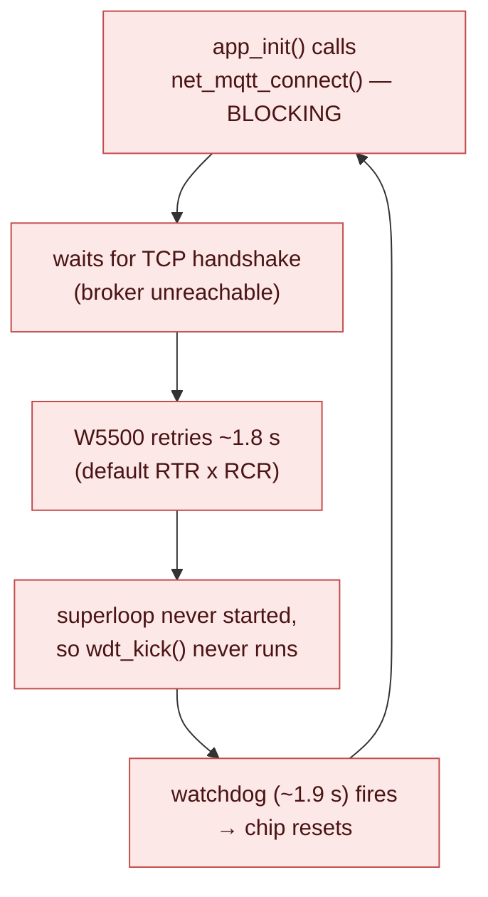

# 6 · Robustness

> The difference between "it worked on the bench" and "it ran for a month in a
> plant." This doc covers the watchdog, the non-blocking logger, and the real
> debugging war story where a blocking connect nearly bricked the node in a
> reset loop — the single best "why is it written that way?" lesson in the repo.

---

## 6.1 The watchdog: a dead-man's switch for firmware

A **watchdog timer (WDT)** is a hardware countdown that **resets the chip unless
the firmware keeps petting it.** You set a period (ours ≈ 1.9 s); if that long
passes without a "kick," the hardware assumes the firmware has hung and reboots
it. It's the automatic recovery for the failure you didn't foresee — an infinite
loop, a deadlock, a wedged peripheral. The node reboots itself and carries on,
untouched, at 3 a.m. with nobody there.

The kick lives in the superloop, once per pass:

```c
for (;;) {
    wdt_kick();          /* "the loop is alive" */
    encoder_task();
    telemetry_task();
    net_mqtt_task();
    ...
}
```

The logic reads "the main loop made it all the way around, so we're healthy."
If any task ever hangs, the kick stops, and ~1.9 s later the chip resets.

### Two gotchas in `wdt.c` worth knowing

[`wdt.c`](../SAMD21_Project/src/services/wdt.c) is tiny but every line is load-bearing:

```c
void wdt_kick(void) {
    if ((WDT_REGS->WDT_STATUS & WDT_STATUS_SYNCBUSY_Msk) != 0U)
        return;                                   /* a previous clear is still syncing */
    WDT_REGS->WDT_CLEAR = (uint8_t)WDT_CLEAR_CLEAR_KEY;   /* 0xA5 — the magic key */
}
```

1. **It's a key, not a flag.** You pet the WDT by writing the specific value
   `0xA5` to the CLEAR register. Writing *anything else* **resets the chip on
   purpose** — that's a hardware safety feature so a random wild write can't
   accidentally disable the watchdog. The key must be exact.

2. **The sync-busy check.** The WDT runs on a slow ~1 kHz clock (GCLK2), a
   different clock domain from the 48 MHz CPU. A clear takes a few WDT cycles to
   cross domains, and writing CLEAR *while a previous clear is still
   synchronising* is ignored at best. So we skip the kick if `SYNCBUSY` is set —
   it's fine, we'll pet it again next loop pass microseconds later.

There's also a config subtlety: this chip's software support package exposes no
WDT driver, so the watchdog is enabled by a **config fuse** (set in MCC, in the
generated `initialization.c`) and is *already running before `main()`*. That's
why `wdt_init()` is empty — there's nothing to start, only to pet. And a WDT
reset is just a normal reset, so reflashing over the debugger is never blocked
by it.

---

## 6.2 The non-blocking logger: never let debug output hang the system

Telemetry and debug text go out over the UART (the virtual COM port). The
*obvious* way is `printf`, but there's a trap: the MCC-generated
`SERCOM5_USART_Write` **spins forever waiting for the transmitter to be ready.**
If the UART ever wedged — a stalled host, a flow-control hiccup — that spin would
hang the superloop, which would stop the watchdog kick, which would reset the
node. A debug *convenience* must never be able to take down the device.

So all logging goes through [`log.c`](../SAMD21_Project/src/services/log.c),
which **drops output rather than block**:

```c
static bool put_byte(char c) {
    uint32_t spins = 0;
    while (!SERCOM5_USART_TransmitterIsReady()) {
        if (++spins >= LOG_SPIN_BUDGET)    /* bounded wait, not forever */
            return false;                  /* give up on this byte */
    }
    SERCOM5_USART_WriteByte((uint8_t)c);
    return true;
}

void log_line(const char *s) {
    while (*s)
        if (!put_byte(*s++)) { s_dropped++; return; }  /* abandon the line */
    ...
}
```

The design: each byte gets a **bounded** number of polls (`LOG_SPIN_BUDGET`,
~4000 — far longer than the ~87 µs a byte takes at 115200 baud, but still a
tiny, *finite* stall). If the TX isn't ready in that budget, we abandon the rest
of the line and increment a dropped-lines counter (`log_dropped()`, for
diagnostics). The telemetry stream is continuous, so a dropped line is
harmless — the next one is 100 ms behind it. **The superloop can never hang on
the UART.** This is the same "match the handling to the data's meaning" instinct
as QoS 0 in doc 5: streaming data would rather drop a sample than stall.

---

## 6.3 The war story: how a blocking connect nearly bricked the node

This is the lesson to really absorb, because it ties doc 4 (the TCP handshake
takes time and can fail), doc 5 (the lazy connect), and this doc (the watchdog)
into one bug.

### What we did first (the natural, wrong thing)

The obvious place to connect to the broker is during startup, in `app.c`'s init,
before the superloop:

```c
/* WRONG — what we tried first */
app_init() {
    ...
    net_mqtt_connect();   /* blocking: waits for the TCP handshake */
    for (;;) { wdt_kick(); ... }   /* superloop starts only AFTER connect returns */
}
```

### What happened on hardware

The node went into a **reset loop** — the startup banner reprinted every ~2
seconds, forever:



Here's the chain spelled out, and it's a beautiful cascade of the concepts
from the earlier docs:

1. `net_mqtt_connect()` is **blocking** — it waits for the TCP three-way
   handshake (doc 4) to complete.
2. If the broker is unreachable (off, wrong IP, cable not in yet), that
   handshake doesn't complete; the W5500's TCP retries for its full timeout.
3. The **default** W5500 retry window is RTR=2000 (200 ms) × RCR=8 ≈ **1.8
   seconds** before it gives up.
4. The watchdog period is ≈ **1.9 seconds** — and the connect was running in
   init, *before the superloop started*, so **`wdt_kick()` was never being
   called** during the handshake.
5. 1.8 s of blocking connect sat right at the 1.9 s watchdog edge. The watchdog
   fired, reset the chip, which started init, which blocked on connect again…
   forever.

A dead broker was bricking a node that had nothing to do with the broker. The
encoder, LCD, and UART never even got to run.

### The three-part fix

Each part addresses one link in the chain:

**(a) Make the connect fail *fast*, safely under the watchdog** — in
`w5500_net_up()` (doc 4):

```c
setRTR(2000U);   /* 200 ms */
setRCR(3U);      /* 3 retries → ~0.8 s total, comfortably under the 1.9 s WDT */
```

Now a failed connect returns cleanly in ~0.8 s instead of ~1.8 s.

**(b) Get the connect *out of init* entirely** — `app.c` no longer connects at
startup. It only brings up the W5500 (VERSIONR, static IP) and then enters the
superloop. The comment in `app.c` records exactly why.

**(c) Connect lazily *inside* the loop, retrying forever** — `net_mqtt_task()`
(doc 5) now does the connecting, so the watchdog gets petted on every pass,
*around* each fast-failing attempt:

```c
for (;;) {
    wdt_kick();          /* ← petted every pass now */
    ...
    net_mqtt_task();     /* ← tries connect here; each attempt fails in <1 s */
}
```

### Why the fix is better than "just make the watchdog longer"

The tempting lazy fix is to widen the watchdog so the blocking connect fits. That
would be exactly backwards. The watchdog's whole value is being *tight* — a long
watchdog means a real hang takes longer to recover. The right fix makes the
blocking operation **short and bounded** and keeps the dog **fed around it**, so
the watchdog stays tight for its actual job.

And the fix bought a feature for free: because the node now retries forever in
the background while running everything else normally, it **tolerates a broker
that's off at boot or comes and goes.** Unplug the broker for an hour and the
node keeps measuring, displaying, and logging; plug it back in and it reconnects
within a few seconds. The robustness and the resilience came from the same
change.

> **The transferable lesson:** never do an unbounded, failure-prone, *blocking*
> operation (a network connect, a disk wait, a sensor handshake) where a
> watchdog or a real-time loop can't tolerate the stall. Make it fast-failing
> and bounded, move it into your normal task cadence, and let it retry. "It
> blocks in init" is one of the most common ways embedded devices get stuck in
> boot loops in the field.

This whole episode is in `CLAUDE.md`'s decisions log and session notes so it's
never re-litigated.

---

## 6.4 The theme across all three

The watchdog, the dropping logger, and the lazy connect are the same philosophy
applied three times:

> **A single misbehaving part — a hung task, a stalled UART, an absent broker —
> must never take down the whole node.** Each is contained: the watchdog
> recovers a hang, the logger drops instead of stalling, the connect retries
> instead of blocking. The encoder keeps turning counts into feet no matter what
> the network, the UART, or the broker is doing.

That containment mindset is what separates a demo from something you'd bolt onto
a production machine.

---

## 6.5 Where to go next

- The other end of the wire — the Python dashboard and *its* resilience choices:
  [doc 7, The Python dashboard](07-the-python-dashboard.md)
