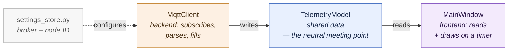
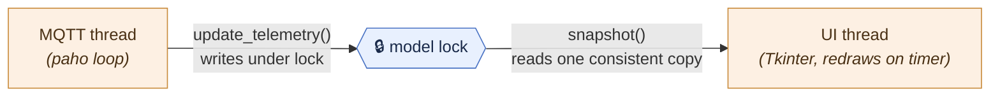

# 7 · The Python Dashboard

> The other end of the wire. The node publishes; something has to subscribe and
> show a human the number. This doc covers the `node_gui/` Tkinter app: its
> structure, paho's threading model, and how its design choices deliberately
> mirror the firmware's. It's a good contrast — the same MQTT protocol, seen
> from the subscriber's side, in a completely different language and environment.

---

## 7.1 The shape: four pieces, one data object in the middle

The app (`node_gui/`) is split into four parts, and the split is the same idea as
the firmware's layering (doc 2). [`main.py`](../node_gui/main.py) wires them
together and is deliberately thin — you can read the whole app's shape in one
screen:



The MQTT side and the UI side never call each other — they only touch the model
in the middle.

- **`settings_store.py`** — loads/saves the broker address and node ID (so a
  customer can re-point the dashboard without editing code).
- **`TelemetryModel`** — a plain data object holding the latest reading. The
  neutral meeting point.
- **`MqttClient`** — the backend: subscribes, parses JSON, fills the model.
- **`MainWindow`** — the frontend: reads the model, draws it, redraws on a timer.

**The model in the middle is the key design choice**, and its own docstring
calls out the parallel: it's the same decoupling as the firmware's `encoder.h`
sitting between the core logic and the hardware. The MQTT side and the UI side
never call each other — they only touch the model. You could swap Tkinter for a
web frontend, or paho for a different MQTT library, and the other half wouldn't
change. Same lesson, different language.

---

## 7.2 The subscriber side: `mqtt_client.py`

This is doc 5's pub/sub model seen from the *other* end. The node publishes;
this subscribes. The structure maps directly onto paho's callbacks.

### Subscribe in `on_connect`, not in `start()` — and why

```python
def _on_connect(self, client, userdata, flags, reason_code, properties):
    self._model.set_broker_connected(True)
    if reason_code == 0:
        client.subscribe(self._telemetry_topic)
        client.subscribe(self._status_topic)
```

This is a correctness pattern worth internalising. **Subscriptions are lost when
a connection drops.** If you subscribed once in `start()`, then the broker
restarted and paho reconnected, you'd be silently connected with no
subscriptions — connected and deaf. By subscribing *inside* `on_connect`, which
paho calls on **every** (re)connect, subscriptions are automatically restored
every time the link comes back. It's the subscriber-side echo of the firmware's
"reconnect and carry on" resilience (doc 6).

### Route by topic in `on_message`

```python
def _on_message(self, client, userdata, msg):
    if msg.topic == self._telemetry_topic:
        self._handle_telemetry(msg.payload)
    elif msg.topic == self._status_topic:
        self._handle_status(msg.payload)
```

Two topics, two handlers: telemetry carries the JSON; status carries the
retained "online"/"offline" presence from doc 5. Because status is **retained**,
this dashboard gets the node's current presence *the instant it subscribes*,
even if the node last changed state hours ago — exactly the late-subscriber
problem doc 5.5 described, now paying off on the receiving end.

### Parsing defensively

```python
def _handle_telemetry(self, payload):
    try:
        data = json.loads(payload.decode("utf-8"))
    except (ValueError, UnicodeDecodeError):
        return                     # skip one bad message, don't crash the thread
    self._model.update_telemetry(data)
```

One malformed message must never kill the network thread. Same instinct as the
firmware dropping a log line rather than hanging (doc 6) — a single bad input is
skipped, and the next good one arrives in a second.

### The firmware parallel, made explicit

`start()` uses `connect_async` + `loop_start`, and its docstring says it plainly:
this "mirrors the firmware's 'keep trying, connect when the broker appears'
behaviour." Both ends treat a missing broker as a normal, temporary condition
they ride out and recover from — not an error that stops them. The two were
written to behave the same way on purpose.

---

## 7.3 Threading: the one genuinely tricky part

This is where a desktop GUI differs sharply from the single-threaded firmware,
and it's the thing most likely to bite you if you don't see it.

**paho runs its network loop on its own background thread** (`loop_start()`).
**Tkinter runs the UI on the main thread.** So the telemetry model is touched by
*two threads at once*: the MQTT thread writing new readings, the UI thread
reading them to draw. Without care, the UI could read a **half-updated** set of
values — a new `count` with an old `rpm`, mid-write. A single lock on the model
serialises them:



[`TelemetryModel`](../node_gui/telemetry_model.py) guards against that with a
lock around every access:

```python
def update_telemetry(self, data):
    with self._lock:               # MQTT thread writes under the lock
        self.count = int(data.get("count", self.count))
        ...

def snapshot(self):
    with self._lock:               # UI thread reads one consistent copy
        return { "count": self.count, "rpm": self.rpm, ... }
```

Two things to note:

1. **`snapshot()` returns one locked, consistent copy** of everything the UI
   needs for one redraw. The UI never holds the lock while drawing, and never
   sees a mix of old and new fields — it grabs a coherent snapshot and renders
   that.

2. **The UI never blocks on the network.** Tkinter redraws on its own timer
   (`start_refresh()`), reading the latest snapshot each time. The MQTT thread
   fills the model whenever messages arrive. They meet only at the locked model.
   This is the GUI analogue of the firmware's non-blocking superloop: the thing
   the human looks at stays responsive no matter what the network is doing.

> **The firmware has one thread and solves timing with the superloop; the GUI
> has two threads and solves it with a lock.** Same goal — never let the slow,
> unpredictable network stall the thing that has to stay live — reached two
> different ways because the environments differ. Recognising *why* each uses
> the tool it does is the real lesson.

---

## 7.4 A couple of thoughtful product touches

Two small features show the "think about the actual user" habit:

**Tare / "total extruded."** The node counts revolutions continuously since
boot. An operator wants "feet since I pressed reset," not "feet since the node
last rebooted." So the model keeps a `_rev_baseline` and reports
`(revolutions − baseline) × feet_per_rev`. Reset just recaptures the baseline.
Crucially, **this is GUI-only — the node is untouched.** The dashboard shouldn't
reach back and mutate the device's count to satisfy one viewer; it does the
subtraction locally. (Note `feet_per_rev` lives on both sides — doc 3's
calibration value — because either end may compute distance.)

**Staleness vs. presence are different things.** The model computes a `stale`
flag (telemetry gone quiet for a few seconds) *separately* from `online` (the
retained presence). That's doc 5's presence contract paying off in the UI: the
dashboard can show "node online but shaft stopped" (stale, online) differently
from "node dead" (offline). Two distinct states a naive dashboard would collapse
into "no data."

**Re-pointing at a new node clears the old readings.** When the Settings dialog
switches to a different node, `reset_for_new_node()` blanks everything — showing
`node01`'s count against `node02`'s label would be a lie. The honest state during
the switch is "no data yet," and that's what it shows.

---

## 7.5 The takeaway

The dashboard is worth studying precisely because it's the *same protocol* from
the *opposite side*, in a *different language*, under *different constraints*
(two threads, a GUI event loop). Seeing MQTT publish/subscribe, retained
presence, and reconnect-and-carry-on from both ends is what turns "I followed a
tutorial" into "I understand the protocol." And the recurring design move — a
neutral data object between a producer and a consumer so neither depends on the
other — is the single most reusable idea in the whole project, appearing as
`encoder.h` in the firmware and `TelemetryModel` here.

---

## 7.6 Where to go next

- The capstone: how you'd build this whole thing yourself, in what order, and
  what to watch for: [doc 8, From scratch](08-from-scratch.md)
